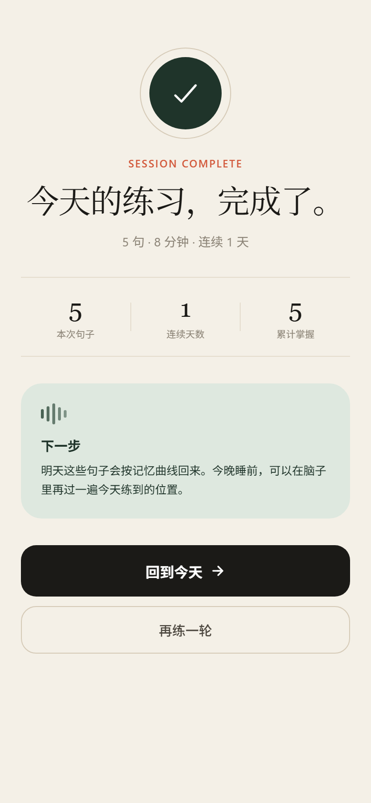
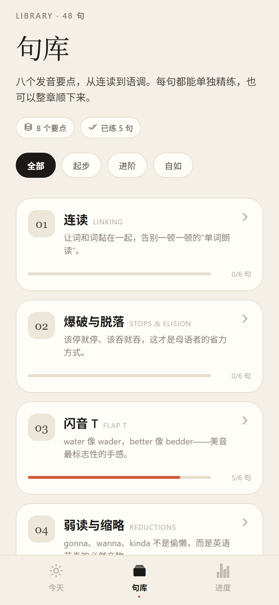
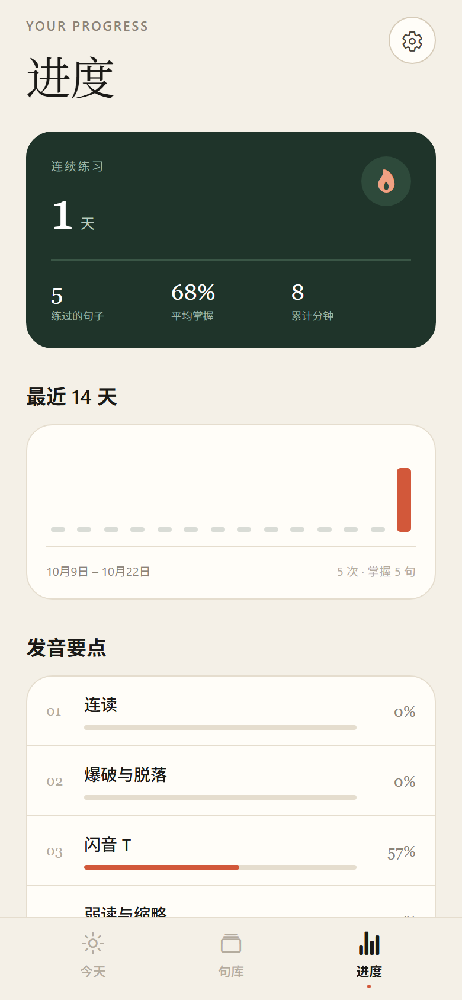

# Echo 口语

> 把美式口语，练成肌肉记忆。

Echo 是一款面向大学生、研究生的美式英语口语训练 App。它把连读、爆破、闪音、弱读、节奏、语调等发音要点拆成 48 句经典例句，按你的水平和每日时间生成学习计划，并用间隔重复安排复习。

用 React Native + Expo 编写，一套代码可以跑在 iOS、Android 和 Web 上。


## 界面预览

| 引导 | 今日任务 | 逐句精练 |
| --- | --- | --- |
|  |  |  |

| 完成 | 句库 | 进度 |
| --- | --- | --- |
|  |  |  |

截图来自 Web 版（390 × 844），原生端布局一致。

## 功能

- **定位测评**：5 道发音小测 + 口语状态自评，推荐起始章节与每日句数。
- **每日计划**：根据水平、每日 5/10/15 分钟目标自动编排，先复习薄弱句，再推进新内容。
- **逐句精练**：标准朗读（可 0.7× 慢速）、IPA、中文听感拆解、最小练习、跟读录音回放。
- **自评与复习**：练完给「再来一次 / 还行 / 很顺」，按评分计算掌握度并安排下次复习。
- **48 句句库**：8 个发音模块，可整章顺练，也可单句精练。
- **进度追踪**：连续天数、14 天练习量、模块掌握度、最该补的一块。
- **本地优先**：不需要注册，所有进度保存在设备本地（AsyncStorage）。

## 课程结构

| # | 模块 | 英文 | 重点 |
|---|------|------|------|
| 01 | 连读 | Linking | 辅音+元音、滑音 /w/ /j/、鼻音衔接 |
| 02 | 爆破与脱落 | Stops & Elision | 失去爆破、词尾 t 脱落 |
| 03 | 闪音 T | Flap T | water / better / got a lot of |
| 04 | 弱读与缩略 | Reductions | gonna、wanna、kinda、could you |
| 05 | 重音与节奏 | Stress & Rhythm | 实词重读、对比重音、重音计时 |
| 06 | 语调与意群 | Intonation | 升降调、列举、换气与信息焦点 |
| 07 | 易混元音 | Vowels | /iː/–/ɪ/、/æ/–/e/、/ʌ/–/ɔː/ |
| 08 | 难缠辅音 | Tricky Consonants | th、r/l、v/w、-ed、-s |

每句包含：英文原句、宽式美音 IPA、发音要点标签、听感拆解、最小练习，以及一个高亮标注（`{连读块}`、`*重读词*`）。

## 运行

需要 Node.js 20+ 和 npm。

```bash
cd echo-speaking
npm install
npx expo start
```

- **真机（推荐）**：手机安装 Expo Go，扫描终端二维码。Expo Go 需要支持当前 SDK 版本（本项目 SDK 58）。
- **Android 模拟器**：`npm run android`
- **iOS 模拟器**（仅 macOS）：`npm run ios`
- **浏览器预览**：`npm run web`

### Windows 长路径提示

React Native 的源码目录很深。如果 `node_modules` 安装时报路径过长 / 文件缺失：

1. 在「设置 → 系统 → 开发者选项」中打开「长路径支持」，或
2. 把项目放到较短路径（例如 `D:\apps\echo`）再安装，或
3. 用 npm 安装（本项目已验证 npm 的扁平 `node_modules` 结构可用）。

### 安装源

项目里的 `.npmrc` 使用腾讯云 npm 镜像，方便国内网络安装；如果不在国内，可以删除 `.npmrc`，并把 `package-lock.json` 里的 `resolved` 地址替换为官方源后重新安装。

### 常用脚本

```bash
npm run typecheck   # TypeScript 类型检查
npm run export:web  # 导出静态 Web 版本到 dist/
```

当前目录已经装好依赖，可以直接 `npm start`；如果把项目移动到别处，重新执行 `npm install` 即可。`dist/` 里是构建好的 Web 版，可用 `node tools/serve.mjs dist 8099` 本地预览。

## 装到手机

### 最快：Expo Go（无需打包）

1. 手机应用商店搜索并安装 **Expo Go**；
2. 电脑上进入项目目录，运行 `npm start`；
3. 手机和电脑连同一个 Wi-Fi，用 Expo Go 扫描终端里的二维码。

如果电脑在虚拟机或公司网络里，手机扫码连不上，可以改用隧道模式：

```bash
npx expo start --tunnel
```

首次运行会提示安装 `@expo/ngrok`，按提示确认即可。

### Android 安装包（APK）

需要一个免费的 Expo 账号（<https://expo.dev/signup>），构建在 Expo 云端完成，电脑不需要 Android Studio，也不需要 Git。

**最简单：双击项目根目录的 `build-apk.cmd`**，按提示登录，然后等待构建完成。

手动命令：

```powershell
cd "D:\新建文件夹\echo-speaking"
$env:EAS_NO_VCS = "1"
npx eas-cli@latest login
npx eas-cli@latest build --platform android --profile preview
```

构建完成后终端会输出 APK 下载链接。手机浏览器打开链接下载，安装时允许「安装未知应用」即可。APK 不依赖 Expo Go，可以独立运行。

第一次构建会在 expo.dev 上创建项目、生成并托管 Android 签名证书；`eas.json` 已配置好 `preview` 使用 APK，免费账号排队时间通常几分钟到十几分钟。完整步骤和常见问题见 [打包说明](docs/BUILD_APK.md)。

### iPhone

iOS 不能直接安装 APK，有两种方式：

- **TestFlight**：需要 Apple Developer 账号（每年 $99），`eas build -p ios --profile production` 后 `eas submit`，再在 TestFlight 安装；
- **只想自己用**：直接用上面的 Expo Go 扫码，不需要付费账号。

## 音频说明

标准朗读目前使用设备自带的 **en-US 语音合成**（`expo-speech`）：

- iOS 上通常是 Siri / Samantha 等系统语音；
- Android 上使用 Google TTS 的美音；
- Web 上使用浏览器 `speechSynthesis`。

因此不需要下载音频包，离线也能听。不同设备音色会有差异。

如果要换成真人录音，可以在 `src/types.ts` 的 `Sentence` 上增加 `audioUrl` 字段，并在 `LessonScreen` 播放逻辑里优先使用 `expo-audio` 播放该文件；句式数据集中在 `src/data/curriculum.ts`，替换成本很低。

录音功能使用 `expo-audio`，需要麦克风权限。录音只写入应用本地缓存，不上传服务器。

## 目录

```
App.tsx                     导航壳、启动页、TabBar
src/
  theme.ts                  颜色、字体、间距、圆角
  types.ts                  Profile / Progress / Plan 等类型
  data/curriculum.ts        8 个模块 × 48 句课程数据
  data/placement.ts         测评题、自评、目标、起点推荐
  lib/plan.ts               每日计划、掌握度、连续天数
  lib/speech.ts             en-US 朗读
  lib/dates.ts              本地日期工具
  state/store.tsx           AsyncStorage 持久化与全局状态
  components/               按钮、卡片、富文本句子、录音面板、TabBar
  screens/                  引导、首页、练习、句库、章节、进度、设置
```

## 设计

暖纸色背景 + 墨色文字 + 陶土色强调，衬线字体只用于标题和英文例句。目标是「安静、克制、但每个细节都被照顾到」：

- 例句中的连读块用陶土色标出，重读词加下划线；
- 朗读时波形点亮，录音面板独立成卡；
- 首页只保留今天要做的事，不堆功能。

## 后续可以加

- 真人录音包 / 可替换音频源；
- 基于录音的发音评分（如强制对齐 + 音素打分）；
- 更细的课程（弱读词表、语调轮廓练习）；
- 账号与跨设备同步（当前刻意保持本地优先）。
